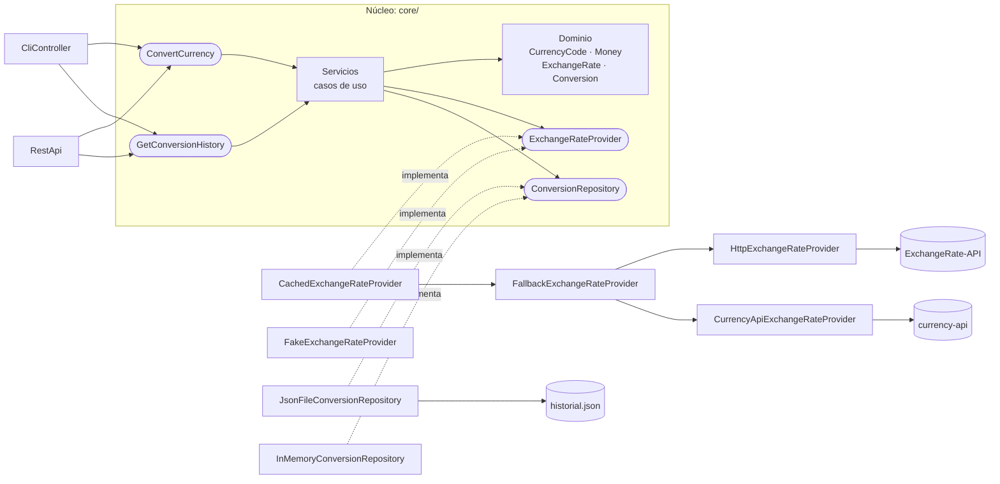

# Conversor de Monedas con Historial

Aplicación que convierte montos entre monedas con tasas reales y guarda un historial. Se usa por **consola** o como **API REST**.
Está construida con **arquitectura hexagonal (puertos y adaptadores)** como caso de estudio.
El análisis y el diseño completos están en [`../propuesta-tecnica-arquitectura-hexagonal.md`](../propuesta-tecnica-arquitectura-hexagonal.md).

## Requisitos

- Python 3.11 o superior. La aplicación **no tiene dependencias externas**: el cliente HTTP es `urllib`, de la librería estándar.
- `pytest`, solo para las pruebas: `python -m pip install -r requirements-dev.txt`

## Uso

```bash
python main.py                    # modo interactivo
python main.py 100 USD COP        # una conversión
python main.py 100 usd a cop      # también se acepta así
python main.py historial          # todo el historial (lo más reciente primero)
python main.py historial 5        # las últimas 5 conversiones
python main.py --servidor         # API REST en http://127.0.0.1:8000 (--host, --puerto)
python main.py --sin-conexion 100 USD COP   # tasas de prueba, sin internet (no son reales)
python main.py --memoria ...      # historial solo durante esta ejecución
```

```
$ python main.py 100 USD COP
100.00 USD = 315,377.36 COP
  Tasa: 1 USD = 3153.773599 COP (actualizada 2026-10-20 19:02)
```

### API REST

| Método y ruta | Cuerpo / parámetros | Respuesta |
|---|---|---|
| `GET /salud` | — | `200 {"estado": "ok"}` |
| `POST /conversiones` | `{"monto": "100", "origen": "USD", "destino": "COP"}` | `201` con la conversión |
| `GET /conversiones` | `?limite=5` (opcional) | `200 {"conversiones": [...]}`, la más reciente primero |

```bash
curl -X POST http://127.0.0.1:8000/conversiones -d '{"monto": 100, "origen": "USD", "destino": "COP"}'
```
```json
{
  "id": "fc06de7da9b04725af32bdfa0ff32a74",
  "fecha": "2026-10-21T15:56:17.266394+00:00",
  "original": {"monto": "100", "moneda": "USD"},
  "convertido": {"monto": "315377.36", "moneda": "COP"},
  "tasa": {"valor": "3153.773599", "actualizada": "2026-10-21T00:02:32+00:00"}
}
```

Los montos y las tasas viajan como texto para no perder precisión. Los errores responden `{"error": "...", "tipo": "..."}`:
- `400`: datos inválidos.
- `422`: moneda no soportada.
- `503`: no se pudo obtener la tasa.
- `500`: falla del historial.
- `404` y `405`: ruta o método incorrectos.
- `413`: cuerpo demasiado grande.

La consola y la API REST usan **los mismos puertos de entrada y el mismo historial**. Agregar la API no cambió nada del núcleo.

### Configuración

| Variable de entorno | Uso |
|---|---|
| `EXCHANGE_RATE_API_KEY` | Clave opcional de ExchangeRate-API. Sin ella se usa el endpoint abierto `open.er-api.com`. |
| `CONVERSOR_HISTORIAL` | Ruta del archivo de historial (por defecto `historial.json` junto a `main.py`). |

## Arquitectura



Con conexión, `main.py` arma el proveedor de tasas como `Cached(Fallback(ExchangeRate-API, currency-api))`. Las tres piezas implementan el mismo puerto `ExchangeRateProvider`, así que el núcleo sigue viendo un solo proveedor:
- **Caché** (patrón decorador): reutiliza cada tasa durante 30 minutos, porque las APIs gratuitas solo la actualizan una vez al día.
- **Respaldo** (patrón compuesto): si ExchangeRate-API está caída o no maneja una moneda, responde currency-api (riesgos R1 y R2).

```
core/                       el hexágono: solo importa core/ y librería estándar pura
├── domain/                 objetos de valor, entidad Conversion y errores del dominio
└── application/
    ├── ports/inbound/      ConvertCurrency, GetConversionHistory
    ├── ports/outbound/     ExchangeRateProvider, ConversionRepository
    └── services/           implementación de los casos de uso
adapters/
├── inbound/                CliController, RestApi
└── outbound/               ExchangeRate-API, currency-api, caché, respaldo, Fake, InMemory, JsonFile
main.py                     composition root: único lugar que elige los adaptadores
tests/                      core/ con adaptadores falsos · adapters/ · arquitectura · main
```

> En Python `in` es palabra reservada, por eso las carpetas `in/` y `out/` del diseño se llaman `inbound/` y `outbound/`.

**Decisiones importantes**

- **Dinero con `Decimal`, nunca `float`** (RNF-06). Incluso el JSON de la API se lee con `parse_float=Decimal`, y el historial guarda montos y tasas como texto.
- **Errores del dominio.** Cada adaptador traduce sus fallos técnicos (red, timeout, JSON inválido, archivo dañado) a errores del dominio. La consola los muestra como `Error: ...` y sigue funcionando (RNF-05).
- **Validación antes de llamar a la API.** Si el monto o los códigos son inválidos, no se hace ninguna consulta.
- **Misma moneda (USD a USD):** el núcleo usa tasa 1 y no consulta al proveedor.
- **Escritura atómica del historial.** Se escribe en un `.tmp` y luego se reemplaza el archivo, así una falla no deja el historial a medias.
- **Solo HTTPS** en el proveedor de tasas, y la clave se lee de una variable de entorno (RNF-08).

## Pruebas

```bash
python -m pytest                                   # 175 pruebas, sin internet
CONVERSOR_PRUEBAS_RED=1 python -m pytest -m red    # 4 pruebas contra las APIs reales
```

`tests/test_architecture.py` **verifica automáticamente la regla de dependencia**. Analiza los imports de cada archivo de `core/` y falla si alguno importa algo fuera de `core/` o de una lista de módulos de la librería estándar sin E/S. También comprueba que los adaptadores no se importen entre capas ni importen `main`.

El flujo de GitHub Actions ([`.github/workflows/pruebas.yml`](../.github/workflows/pruebas.yml)) ejecuta la suite en Windows, Linux y macOS con Python 3.11 y 3.13 en cada push.
